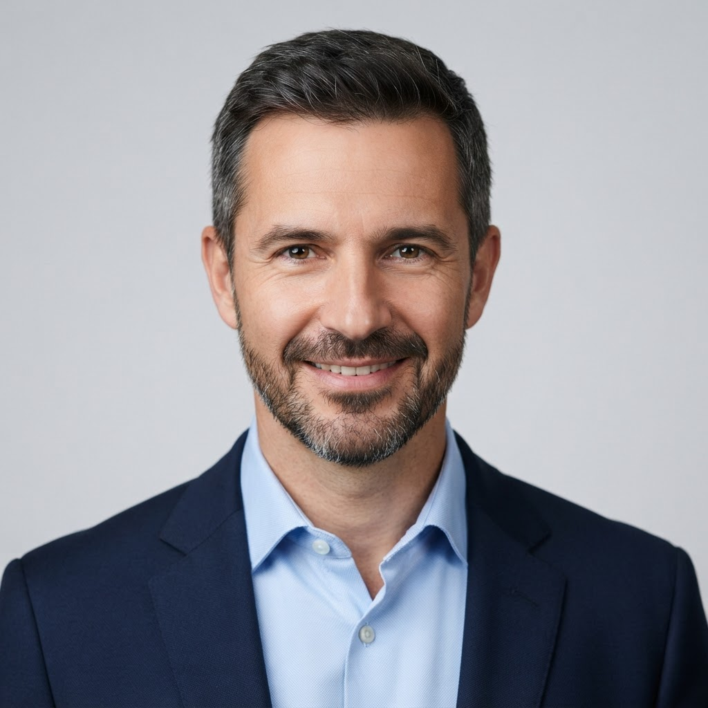

::::: {.page}

<!-- ===================== HEADER ===================== -->
:::: {.header}
::: {.header-main}
# Fernando Millán Villalobos {.name}

[Ground Staff]{.role}

::: {.contact}
[**078 693 09 57**]{.contact-item}
[**fernando.millan.villalobos@gmail.com**]{.contact-item}
[**Eggstrasse 3b, 8124 Maur**]{.contact-item}
[**September 9th 1980**]{.contact-item}
[**Spanish / Swiss**]{.contact-item}
:::
:::

{.avatar}
::::

<!-- ===================== BODY (two columns) ===================== -->
:::: {.columns}

<!-- ---------- LEFT COLUMN ---------- -->
::: {.col .col-left}

## Professional Experience {.section-title}

::: {.entry}
### Ground Staff {.entry-title}
[Zurich Airport (FZAG)]{.entry-org}

[[10/2022 - 07/2025]{.meta} [Zürich, Switzerland]{.meta}]{.entry-meta}

- UA CSR at Gate, Boarding, Transit Check-In; DocCheck (+AIM), AVSEC; Aircraft Protection (+FZAG driving permit), Checkport
:::

::: {.entry}
### Layout Designer {.entry-title}
[International advertising agency MRM/McCann]{.entry-org}

[[02/2011 - 04/2011]{.meta} [Madrid, Spain]{.meta}]{.entry-meta}
:::

::: {.entry}
### Graphic Designer {.entry-title}
[Magazine Mujer Hoy Corazón]{.entry-org}

[[07/2009 - 09/2009]{.meta} [Madrid, Spain]{.meta}]{.entry-meta}
:::

::: {.entry}
### Graphic Designer {.entry-title}
[FHM Magazine]{.entry-org}

[[08/2007 - 04/2009]{.meta} [Madrid, Spain]{.meta}]{.entry-meta}
:::

::: {.entry}
### Layout Designer {.entry-title}
[On Madrid, Leisure Guide of El País]{.entry-org}

[[02/2007 - 08/2007]{.meta} [Madrid, Spain]{.meta}]{.entry-meta}
:::

::: {.entry}
### Freelance Graphic Designer {.entry-title}
[Instituto de Práctica Empresarial]{.entry-org}

[[2006 - 2007]{.meta} [Málaga, Spain]{.meta}]{.entry-meta}
:::

::: {.entry}
### Journalist/Graphic Designer {.entry-title}
[Newspaper Granada Hoy]{.entry-org}

[[07/2004 - 09/2004]{.meta} [Granada, Spain]{.meta}]{.entry-meta}
:::

## Education {.section-title}

::: {.entry}
### Visiting Scholar {.entry-title}
[Institut für Interaktive Technologien (FHNW)]{.entry-org}

[[12/2020 - 12/2021]{.meta} [Brugg-Windisch, Argau]{.meta}]{.entry-meta}
:::

::: {.entry}
### BSc Data Science {.entry-title}
[FHNW]{.entry-org}

[[09/2019 - 09/2020]{.meta} [Brugg-Windisch, Argau]{.meta}]{.entry-meta}
:::

:::: {.entry .entry-degree}
::: {.entry-degree-main}
### Degree in Journalism {.entry-title}
[University of Málaga (UMA)]{.entry-org}

[[1998 - 2006]{.meta} [Málaga, Spain]{.meta}]{.entry-meta}
:::
::: {.grade}
[Grade]{.grade-label}
[**good** / 4.0]{.grade-value}
:::
::::

:::

<!-- ---------- RIGHT COLUMN ---------- -->
::: {.col .col-right}

## About Me {.section-title}

[My enthusiasm for communication and interacting with people, and my willingness to embrace new experiences and truly observe, enable not only continuous learning but also constant improvement]{.about}

## Skills {.section-title}

### Software {.sub-title}

::: {.tags}
[Adobe Suite (InDesign, Photoshop, etc.)]{.tag}
:::

### Programming Languages {.sub-title}

::: {.tags}
[HTML5]{.tag} [CSS3]{.tag} [JavaScript]{.tag} [Python]{.tag} [R]{.tag}
:::

## Training / Courses {.section-title}

::: {.course}
[Python Programming Intermediate]{.course-title}
[DataQuest]{.course-org}
:::

::: {.course}
[Data Visualization und Infographics with D3]{.course-title}
[Knight Center for Journalism in the Americas]{.course-org}
:::

::: {.course}
[Data Visualization]{.course-title}
[Universidad Internacional de Andalucía (UNIA)]{.course-org}
:::

::: {.course}
[Web-Design with CSS: Basics]{.course-title}
[EB Zürich]{.course-org}
:::

::: {.course}
[Web-Publishing]{.course-title}
[Centro de Tecnologías de la Información y las Comunicaciones Madrid-Sur]{.course-org}
:::

::: {.course}
[Graphic Design]{.course-title}
[Sistemas de Enseñanza]{.course-org}
:::

::: {.course}
[German as a Foreign Language Level C1]{.course-title}
[ZHAW]{.course-org}
:::

## Languages {.section-title}

:::: {.lang}
::: {.lang-info}
[Spanish]{.lang-name}
[Native]{.lang-level}
:::
[[]{.dot .on}[]{.dot .on}[]{.dot .on}[]{.dot .on}[]{.dot .on}]{.dots aria-label="5 out of 5"}
::::

:::: {.lang}
::: {.lang-info}
[German]{.lang-name}
[Intermediate (B2-C1)]{.lang-level}
:::
[[]{.dot .on}[]{.dot .on}[]{.dot .on}[]{.dot}[]{.dot}]{.dots aria-label="3 out of 5"}
::::

:::: {.lang}
::: {.lang-info}
[English]{.lang-name}
[Advanced (C1)]{.lang-level}
:::
[[]{.dot .on}[]{.dot .on}[]{.dot .on}[]{.dot .on}[]{.dot}]{.dots aria-label="4 out of 5"}
::::

## Interests {.section-title}

[North American literature]{.interest}

[Basketball coach for seven years]{.interest}

:::

::::

:::::

<!-- ============================================================= -->
<!-- =====================  PAGE 2  =============================== -->
<!-- Duplicate this whole block to add more pages. Fill the columns -->
<!-- with the same .entry / .course / .tag patterns used on page 1. -->
<!-- ============================================================= -->

::::: {.page}

<!-- Compact continuation header -->
:::: {.header-cont}
[Fernando Millán Villalobos]{.cont-name}
[Page 2]{.cont-page}
::::

:::: {.columns}

<!-- ---------- LEFT COLUMN ---------- -->
::: {.col .col-left}

## Projects {.section-title}

::: {.entry}
### Project Title {.entry-title}
[Organization / Client]{.entry-org}

[[MM/YYYY - MM/YYYY]{.meta} [Location]{.meta}]{.entry-meta}

- Describe the project, your role, and the outcome here.
:::

:::

<!-- ---------- RIGHT COLUMN ---------- -->
::: {.col .col-right}

## References {.section-title}

::: {.course}
[Reference Name]{.course-title}
[Title, Company — contact]{.course-org}
:::

:::

::::

:::::
